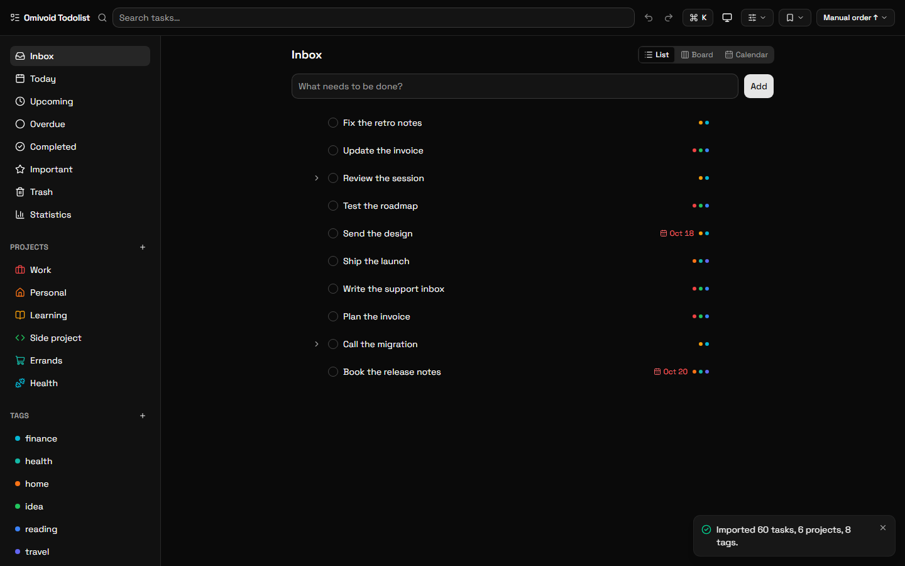
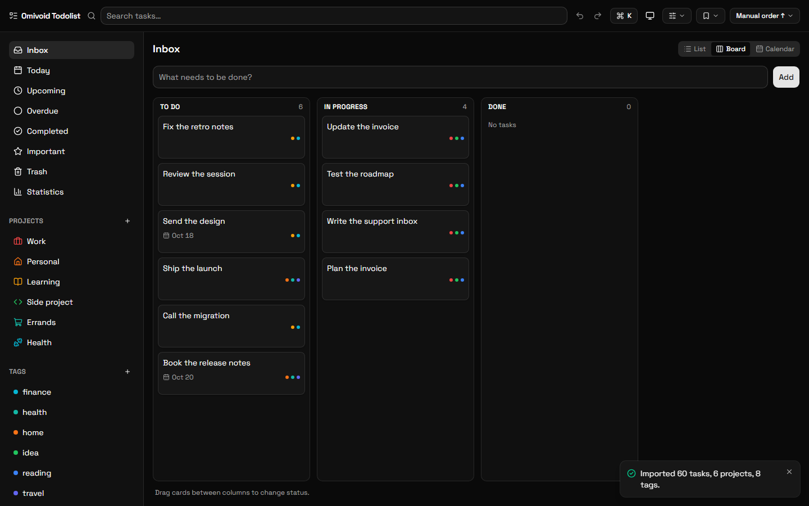
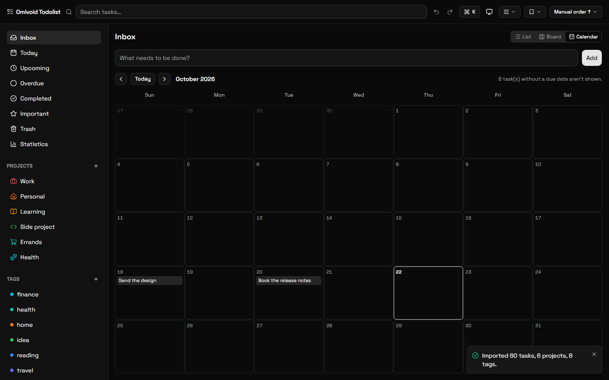
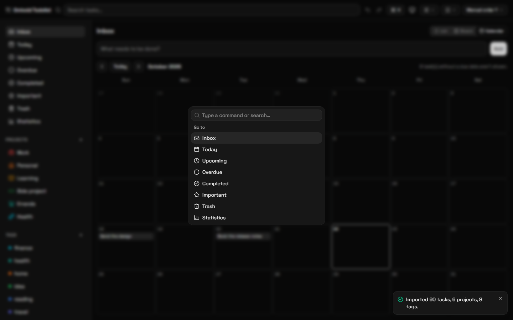
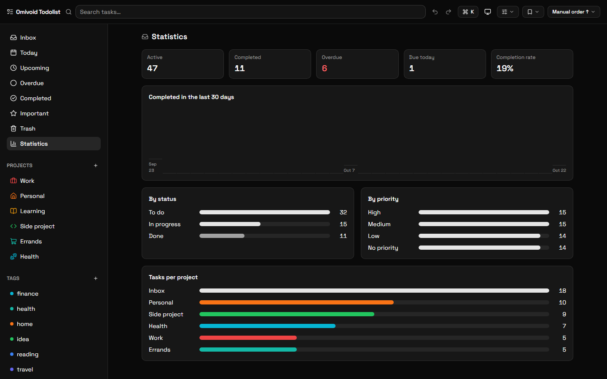
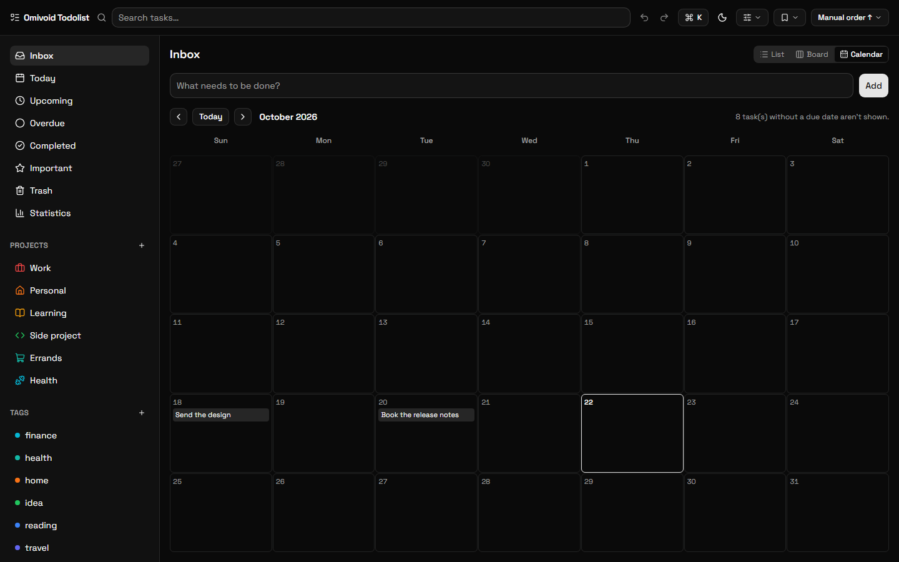

# Omivoid

[](https://github.com/Marsh-Edge/Omivoid-Todolist/actions/workflows/ci.yml) · [MIT License](LICENSE) · [Latest release](https://github.com/Marsh-Edge/Omivoid-Todolist/releases/latest) · [Report a bug](https://github.com/Marsh-Edge/Omivoid-Todolist/issues/new/choose) · [Security policy](SECURITY.md)

**A local-first todo / task manager.** Everything is stored on your device in
IndexedDB — there are **no network requests, no accounts, and no telemetry**,
ever (not even fonts or icons; they are bundled locally). Ships as a web
static export and as a desktop app (Electron).

> Your tasks never leave your machine. Not for analytics, not for sync, not for
> "improvements". There is no server component to leak them to.

## Screenshots

| List | Kanban board |
| :---: | :---: |
|  |  |

| Month calendar | Command palette |
| :---: | :---: |
|  |  |

| Statistics | Dark theme |
| :---: | :---: |
|  |  |

<sub>
Captured from the static export with <code>npm run screenshots</code>, using
synthetic seed data.
</sub>

## Download

Get the latest build from the
[releases page](https://github.com/Marsh-Edge/Omivoid-Todolist/releases/latest).

| Platform | Asset | Notes |
| --- | --- | --- |
| Windows | `Omivoid-<version>-setup.exe` | NSIS installer, installs per user by default |
| Linux | `Omivoid-<version>.AppImage` | `chmod +x` the file, then run it |

The release builds are **unsigned**, so Windows SmartScreen may show
"Windows protected your PC" on the first run — choose **More info → Run
anyway**. Verify the download with the published checksums instead:

```bash
# Linux
sha256sum -c SHA256SUMS.txt

# Windows PowerShell
Get-FileHash .\Omivoid-<version>-setup.exe -Algorithm SHA256
```

Compare the digest with the matching line in `SHA256SUMS.txt` from the same
release. See [Release verification](#release-verification--smartscreen) for
details.

Prefer to run it in a browser? The web build is a plain static export — see
[Run the web build locally](#run-the-web-build-locally).

## Features

- Tasks with subtasks, priority, status, due date/time, tags (colors), projects (nesting, icons + colors)
- Smart views: Inbox, Today, Upcoming, Overdue, Completed, Important, Trash (restore)
- List, **Kanban board** and **month calendar** view modes (lazy-loaded)
- **Markdown notes** per task with `[[wiki links]]` and a backlinks panel
- **Natural-language quick-add** (`Submit report !high #work tomorrow 5pm`)
- **Recurring tasks** (completing one reschedules the next occurrence)
- **Desktop notifications** for tasks as they come due
- **Undo / redo** (`Ctrl/Cmd+Z`, `Ctrl/Cmd+Shift+Z`, `Ctrl/Cmd+Y`) and **rolling local backups**
- **Lightweight charts** on a global `/stats` page (completions trend, status/priority breakdown, tasks per project)
- Instant local search, filters, sort and group-by, plus **saved filter presets**
- Command palette (`Ctrl/Cmd+K`) and keyboard shortcuts (`Ctrl/Cmd+F` search, `Ctrl/Cmd+N` quick-add)
- Dark / light / system theme
- Export / import all data as a JSON backup; export the current view or everything as **Markdown**
- Virtualized lists and board columns for large datasets (smooth at 10,000+ tasks)
- Desktop extras: **system tray** (closing the window keeps the app running), **global quick-add** (`Ctrl/Cmd+Alt+N`), window size/position memory, and a single-instance lock
- Accessibility: skip-to-content link, focus-managed detail panel, keyboard status moves on the board, `prefers-reduced-motion` support

## Stack

- **Next.js 16** with `output: 'export'` (static, client-only; no API routes/SSR)
- **Dexie / IndexedDB** for storage, with **Zod**-validated repositories
- **Zustand** (selector-based) for UI state
- **Tailwind v4** + shadcn/ui, **lucide-react**, **Space Grotesk** (all bundled locally)
- **Electron** shell with `contextIsolation`, `sandbox`, and a loopback-only static server

## Requirements

- Node.js 22.15+ (for development)
- Windows (NSIS) or Linux (AppImage) for packaging the desktop app

On Windows PowerShell, the execution policy may block `npm.ps1` — invoke
`npm.cmd` / `npx.cmd` instead.

## Develop

```bash
npm install
npm run dev        # web dev server with HMR at http://localhost:3000
```

## Test & lint

```bash
npm run test            # Vitest (fake-indexeddb for the DB layer)
npm run test:watch
npm run test:coverage   # informational, no threshold gate
npm run lint
npm run typecheck       # tsc --noEmit for the renderer code
npm run verify          # lint + typecheck + test
```

## Build (web static export)

```bash
npm run build      # emits ./out
npm run serve      # serves ./out at http://127.0.0.1:3000 (loopback only)
```

## Run the web build locally

The static export is a normal web app — it runs from any static file server:

```bash
npm run build
npm run serve      # → http://127.0.0.1:3000
```

Your data is stored in the browser profile's IndexedDB, so it stays on the
machine that opened it. `npm run serve` mirrors the desktop app's loopback-only
server and never accepts connections from the network.

## Sample data (seed)

Generate a synthetic data set without typing anything:

```bash
npm run seed                 # 100 tasks (default)
npm run seed -- --count 1000 # custom size
npm run seed -- --out x.json # custom output file
```

This writes `omivoid-seed.json` (a valid Omivoid backup) in the project root.
Import it in the app via the command palette (`Ctrl/Cmd+K` → **Import data
(JSON)**); importing replaces all current data. `omivoid-seed.json` is
gitignored.

## Data & backups

- All data lives in IndexedDB on the app's origin (browser profile / Electron userData). Nothing leaves the device.
- Rolling snapshots: the 5 newest are kept automatically (one per app start, at most every ~6 h). Manage them from the command palette → **Backups**; restore replaces all data after validation.
- JSON export/import covers tasks, projects, tags, and saved filters.
- Desktop window state is stored in `window-state.json` in the Electron userData folder.

## Desktop (Electron)

```bash
npm run electron:compile   # type-check/compile the Electron shell only
npm run electron:dev       # next build -> tsc -> electron . (production-like)
npm run electron:build     # next build -> tsc -> electron-builder --win
```

`electron:dev` uses a full static build, so renderer changes require re-running
it; use `npm run dev` for fast web iteration. In production the renderer is
served from `http://127.0.0.1:41739` (a fixed loopback origin) so IndexedDB
persistence survives restarts.

Electron 44 fetches its runtime on first use instead of during `npm install`,
so the very first `npm run electron:dev` downloads it (~100 MB, once). The web
build never needs it.

Closing the window hides Omivoid to the system tray rather than quitting; use
the tray menu's **Quit Omivoid** (or the app menu) to exit. `Ctrl/Cmd+Alt+N`
focuses the quick-add box from anywhere.

### Packaging

```bash
npm run electron:build:win     # Windows → release/Omivoid-<version>-setup.exe
npm run electron:build:linux   # Linux   → release/Omivoid-<version>.AppImage
```

Notes:

- App icon: `build/icon.png` (512×512), auto-detected by electron-builder (`buildResources: build`).
- The packaged `app.asar` is ~1.4 MB: only the static export and the compiled shell are included — runtime `node_modules` are excluded (the shell uses Electron/Node built-ins only).
- On Linux, the system tray needs a desktop environment with AppIndicator support.

### Release verification & SmartScreen

Release builds are **unsigned** (no code-signing certificate), so Windows
SmartScreen may warn "Windows protected your PC" on first run — click
**More info → Run anyway**. Verify the download integrity instead with the
published checksums:

```bash
npm run release:checksums   # writes release/SHA256SUMS.txt (sha256sum format)
```

On Windows: `Get-FileHash .\Omivoid-<version>-setup.exe -Algorithm SHA256`
and compare against `SHA256SUMS.txt`; on Linux: `sha256sum -c SHA256SUMS.txt`.

Hardening applied in production builds: strict hash-based CSP served by the
loopback static server, Electron fuses (ASAR integrity, `RunAsNode` off, etc.),
DevTools disabled, permission lockdown (notifications only), a non-loopback
request guard, and no external network access of any kind.

## Project status

All planned phases (1–14) are complete — see [`PLAN.md`](PLAN.md) for the
detailed history and [`AGENTS.md`](AGENTS.md) for the permanent project rules.
The current release is **v0.1.0**; see the
[changelog](CHANGELOG.md) for what it contains.

## Contributing

Pull requests are welcome — please read
[`CONTRIBUTING.md`](CONTRIBUTING.md) first. The short version: the app stays
local-only, TypeScript is strict without `any`, everything that reaches
IndexedDB is validated with Zod, and `npm run verify` plus `npm run build`
must pass before a change is merged.

Screenshots in this README are generated with:

```bash
npm run build
npm run seed
npm run serve          # in one terminal
npm run screenshots    # in another
```

## Security

Please report vulnerabilities privately — see
[`SECURITY.md`](SECURITY.md). Never paste database contents or exported
backups into a public issue.

## Architecture pointers

| Area | Where |
| --- | --- |
| Database schema + migrations (Dexie v1–v7) | `src/db/` |
| Repository layer (only code that touches Dexie; Zod-validated) | `src/db/*Repository.ts` |
| Pure logic (filters, recurrence, NL parsing, stats, …) | `src/lib/` |
| Features (tasks, board, calendar, notes, stats, …) | `src/features/` |
| Electron main process + window state | `electron/` |
| Phase-by-phase development plan | `PLAN.md` |
| Permanent project rules | `AGENTS.md` |

## License

[MIT](LICENSE) © 2026 Edge Quantum
